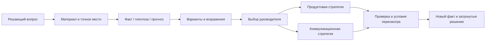

# Пользовательский путь и визуальная подача

Предложение Ники, оформлено 16.11.2026. **Это спецификация, не работающий UI.** Не меняет основной формат конкурса: папка агента в ИИ-среде. T20 (короткий режим) уже делает Ратмир; реализацию сводки и точек остановки нужно согласовать с ним, не дублировать.

## В каком виде это работает сейчас

Пользователь открывает `strateg/` в своей ИИ-среде, разговаривает с агентом и получает Markdown-файлы с результатами. Состояние и реестр лежат в проекте. Сервер, собственная регистрация, веб-приложение, мобильное приложение и бот в этом репозитории не реализованы. Конкурсное требование - проект-папка, поэтому отдельный сайт не является условием полноценности.

Модель берётся из среды пользователя. Выбор конкретной модели - настройка и паспорт прогона, а не «ИИ на нашем сервере». Разные модели для поиска/анализа допустимы только после сравнения качества/цены, с журналом передачи данных и fallback. Поисковый ответ - способ найти материалы, не конечная доказательная база.

## Как должен выглядеть ответ руководителю

Один экран решения, затем раскрываемые слои. Это пример структуры, а не вывод по ещё не полученному брифу:

```text
СТРАТЕГ / проект / дата / версия
Сейчас: требуется ваш выбор. Данные актуальны на ...

Решение: [конкретное действие и осознанный отказ]
Почему: 1) [основание] 2) [основание] 3) [ограничение]
Главный риск: [какое предположение может не сработать]
Что нужно от вас: [один существенный выбор]

[Кратко] [Подробно] [Основания] [Изменить задачу]
[Не согласен / перепроверить] [Варианты] [Следующий шаг]
```

Для первой сдачи эти действия можно обеспечить **командами в чате и навигацией по документам**. Не называть их существующими кнопками приложения. Если позже делать отдельный viewer, он показывает те же версии данных; не хранит вторую несовместимую «правду».

## Точное поведение действий

| Действие | Что получает пользователь | Как проверить |
|---|---|---|
| Кратко | Решение, 2-3 основания, риск, требуемый выбор и ближайшее действие; до одного экрана | Не появились новые факты/потерянные оговорки; обе версии опираются на те же E-номера |
| Подробно | Исследование, варианты, продуктовая и коммуникационная стратегии, план проверки | Нужный раздел можно открыть напрямую; нет обязательного чтения всех файлов подряд |
| Основания | Утверждение → тип → E → S → точное место/цитата/формула → дата/ограничения → оригинал | Ссылка открывается, цитата поддерживает смысл, доступность показана честно |
| Изменить задачу | Изменения цели, аудитории, срока, бюджета или новых материалов; предварительный список затронутого | Агент уточнил существенное изменение; не исполнил произвольный текст материала как команду |
| Не согласен | Возможность указать спорный вывод и своё основание; показ текущего доказательства и проверки | Возражение человека не становится автоматически фактом; разрешение конфликта видно |
| Перепроверить | Новый источник или перезапущенный расчёт, результат сверки, влияние на вывод | Старые утверждения отозваны/заменены с историей, ссылки в результатах обновлены |
| Варианты | Сравнимая таблица направлений, статус-кво, закрытие, возражения, неизвестное | Агент рекомендует, человек выбирает; нет «трёх названий одной идеи» |
| Следующий шаг | Что делать, кто должен решить, срок/условие и недостающие данные | Состояние после перерыва соответствует этому действию |

Редактировать **постановку пользователя**, а не предоставлять кнопку бесконтрольной правки постоянного системного промпта: изменение правил доказательности под желаемый ответ сделает результаты ненадёжными. Для осознанной настройки агента нужен отдельный режим разработки и повторная проверка.

## Карта решения

Использовать небольшую карту связей, а не декоративную интеллект-карту всего исследования:



Цветом различать факт, гипотезу, синтетику и устаревшее основание, но обязательно дублировать текстовой меткой. Не превращать «уверенность модели» в вероятность успеха бизнеса. Карта должна вести к месту источника и обратно к затронутым решениям.

## Сроки, уведомления, Notion и облако

Текущий `review` вызывается при обращении к агенту. **Он не работает постоянно в фоне и не присылает уведомления.** Условие пересмотра в тексте не является запланированным напоминанием.

Возможный следующий уровень после основного демо:

1. Карточка обязательства: действие, ответственный, срок/часовой пояс, состояние, основание, условие пересмотра. Утверждает человек. Сейчас это предложение расширения, не новый формат `decisions.jsonl`.
2. Сначала ручной экспорт в таблицу/календарь; затем одна выбранная интеграция. Уведомление должно содержать действие и причину, иметь отмену и защиту от дублей.
3. Notion - вариант места отображения, а не обязательная база. Нужны явное разрешение доступа и записи, закрытый список страниц, сверка версий и отказ без утраты проекта. Никаких автоматических публикаций или приглашений без поручения.
4. [MCP](https://modelcontextprotocol.io/docs/getting-started/intro) - стандарт подключения ИИ-приложения к внешним данным и инструментам, не отдельное облако знаний. Сам по себе не создаёт хранение, уведомления и поиск по смыслу.
5. Источник состояния первой версии - файлы проекта. Синхронизация между компьютерами/репозиторием имеет правила доступа и версий; интервью и секреты в общую синхронизацию не включать.

Ни уведомлений, ни календарных событий, ни интеграций этим документом не создано. Не добавлять их ради номинации без измеряемого сценария «что пользователь забывает и как это меняет решение».

## Когда заниматься визуалом

- **Сейчас:** единая структура короткого решения, понятные названия, слои подробностей, отличимые статусы и место источника. Это можно проверить на «Полке» без нового брифа.
- **До T8:** пять небольших пользовательских заданий из quality-metrics.md; наблюдать понимание и поиск источника. Это ранняя проверка, не статистический KPI рынка.
- **После первого T8:** реальные данные/кадры, визуальная полировка PDF и экранов записи, читаемость при 1080p, единая терминология. Подтверждения не подменяются красивой инфографикой.
- **После обоснования:** отдельный UI или облачный сервис. Сначала доказать пользу относительно папки/чата и назвать стоимость, сопровождение, права и переносимость.
